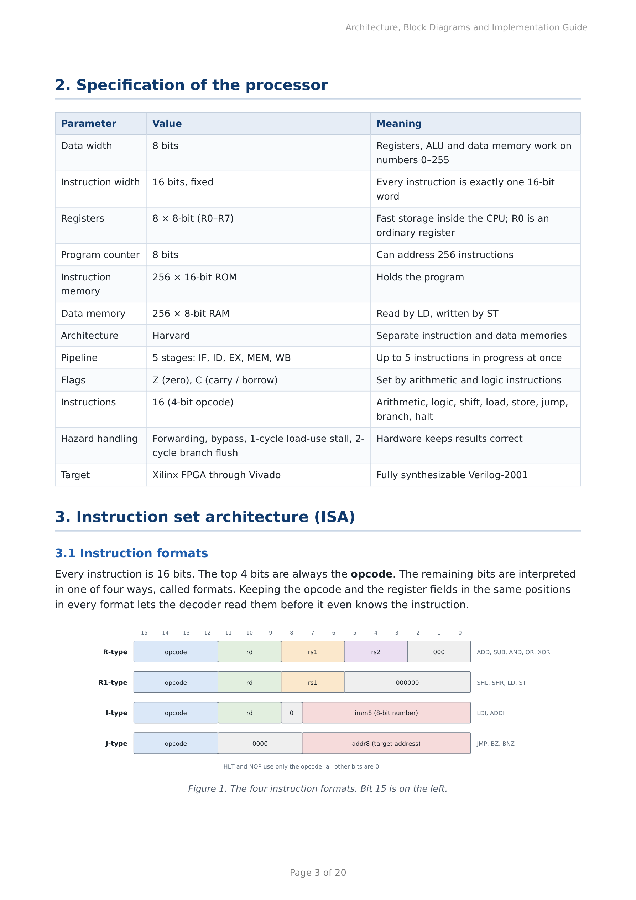
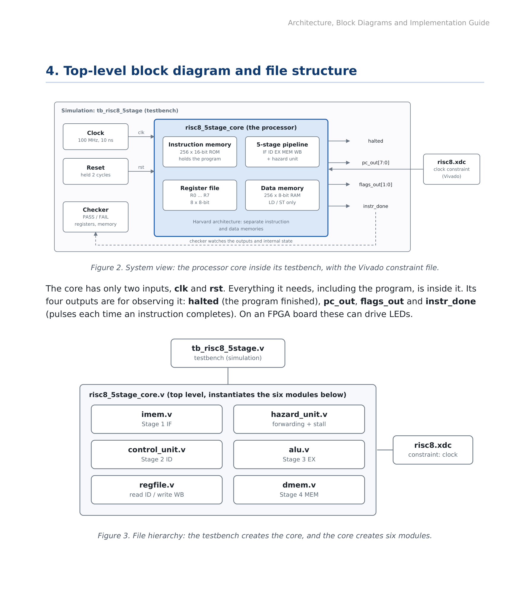
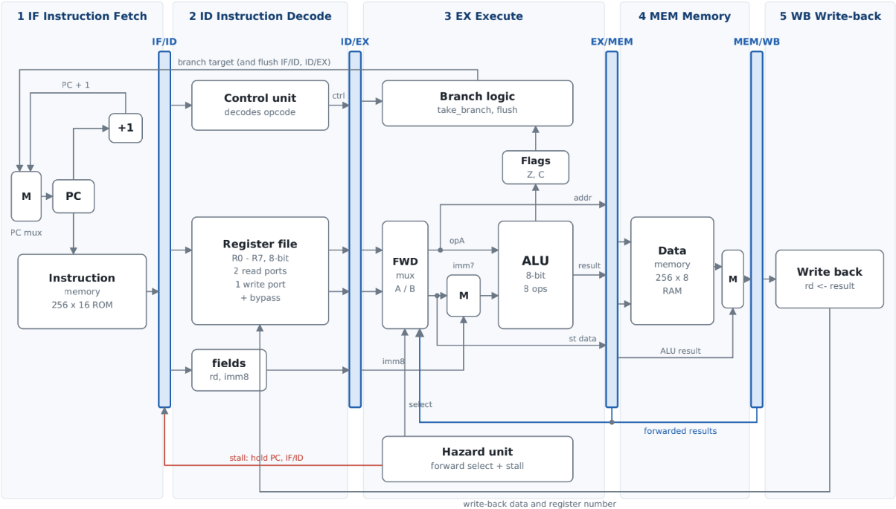
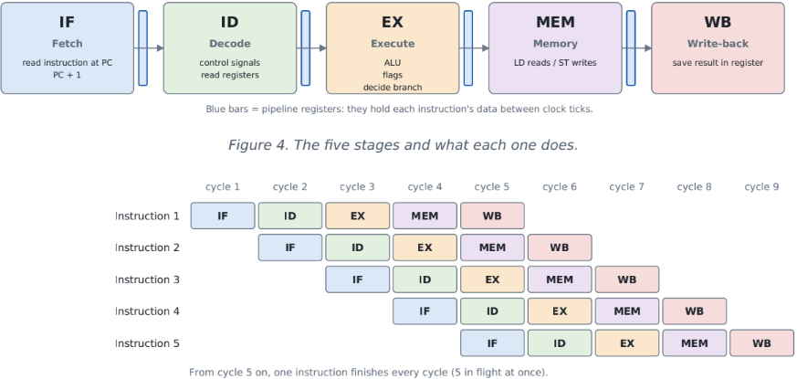
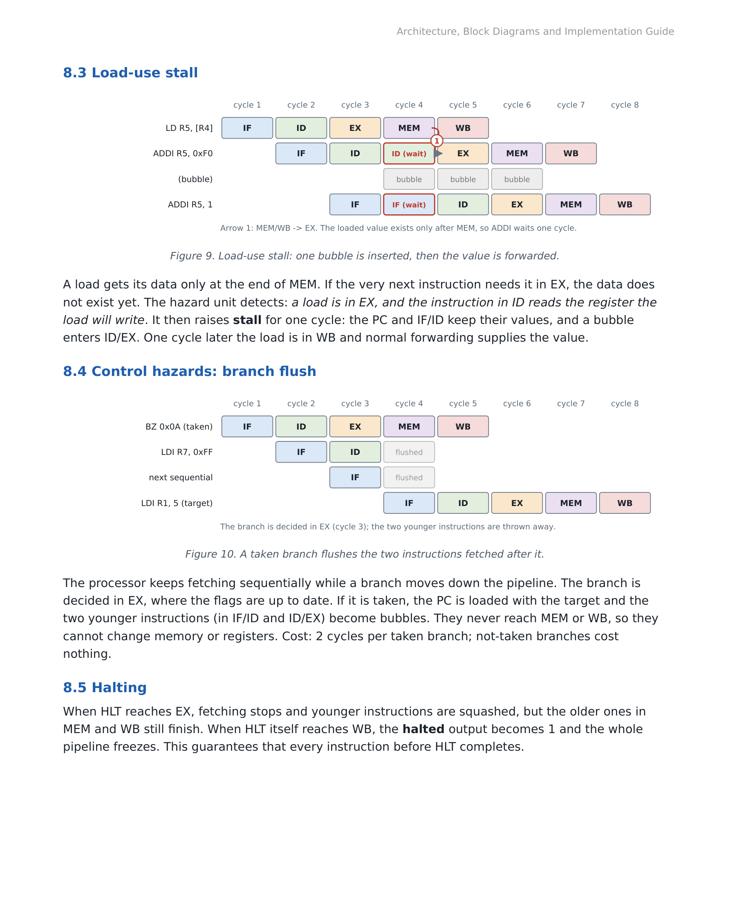

[Uploading README.md…]()
# 8-bit RISC Processor Core — 5-Stage Pipeline in Verilog

<div align="center">


</div>

---

A fully functional **8-bit RISC CPU** with a classic 5-stage pipeline (**IF → ID → EX → MEM → WB**) written in synthesisable Verilog-2001. The processor handles all three pipeline hazard classes entirely in hardware — no stall instructions needed in software — and is verified at two levels: directed self-checking testbenches and a differential random-test harness comparing 500 random programs against a Python golden model.

> **Predecessor project:** [4-bit 3-stage Pipelined RISC CPU](https://github.com/Hudo1501/4bit-pipelined-risc-cpu-verilog) — this project extends the data path to 8 bits, adds a full fifth stage (MEM), full forwarding, a load-use stall and a Python ISS.

---

## Table of Contents

1. [Processor Specification](#1-processor-specification)
2. [Instruction Set Architecture (ISA)](#2-instruction-set-architecture-isa)
3. [Architecture & Datapath](#3-architecture--datapath)
4. [Pipeline Theory](#4-pipeline-theory)
5. [Hazard Handling](#5-hazard-handling)
6. [File Structure](#6-file-structure)
7. [How to Run](#7-how-to-run)
8. [Simulation Results](#8-simulation-results)
9. [Vivado Flow](#9-vivado-flow)

---

## 1. Processor Specification

| Parameter | Value | Note |
|---|---|---|
| Data width | **8-bit** | Registers, ALU and data memory work on values 0–255 |
| Instruction width | **16-bit, fixed** | Every instruction is exactly one 16-bit word |
| Registers | **8 × 8-bit** (R0–R7) | R0 is an ordinary register (not hard-wired to zero) |
| Program counter | **8-bit** | Addresses 256 instruction locations |
| Instruction memory | **256 × 16-bit ROM** | Harvard architecture — separate from data |
| Data memory | **256 × 8-bit RAM** | Read by LD, written by ST |
| Architecture | **Harvard** | IF and MEM stages never contend for the same memory |
| Pipeline | **5-stage** IF / ID / EX / MEM / WB | Up to 5 instructions in flight simultaneously |
| Flags | **Z** (zero), **C** (carry / borrow) | Set by arithmetic, logic and shift instructions |
| Instructions | **16** (4-bit opcode) | Arithmetic · logic · shift · load/store · branch · halt |
| Hazard handling | Forwarding + bypass + 1-cycle load-use stall + 2-cycle branch flush | Hardware only — no NOP padding needed |
| Target | **Xilinx Artix-7** through Vivado | Fully synthesisable Verilog-2001, 0 latch warnings |

---

## 2. Instruction Set Architecture (ISA)



Every instruction is **16 bits**. The top 4 bits are always the opcode. The remaining bits are interpreted in one of four formats:

```
R-type  [15:12] opcode | [11:9] rd | [8:6] rs1 | [5:3] rs2 | [2:0] 000    ADD SUB AND OR XOR
R1-type [15:12] opcode | [11:9] rd | [8:6] rs1 | [5:0] 000000             SHL SHR LD ST
I-type  [15:12] opcode | [11:9] rd | [8] 0      | [7:0] imm8              LDI ADDI
J-type  [15:12] opcode | [11:8] 0000            | [7:0] addr8             JMP BZ BNZ
```

### Full instruction table

| Opcode | Mnemonic | Operation | Flags | Format |
|:---:|---|---|:---:|:---:|
| `0x0` | NOP | — | — | — |
| `0x1` | ADD rd, rs1, rs2 | rd = rs1 + rs2 | Z, C | R |
| `0x2` | SUB rd, rs1, rs2 | rd = rs1 − rs2 | Z, C | R |
| `0x3` | AND rd, rs1, rs2 | rd = rs1 AND rs2 | Z | R |
| `0x4` | OR rd, rs1, rs2 | rd = rs1 OR rs2 | Z | R |
| `0x5` | XOR rd, rs1, rs2 | rd = rs1 XOR rs2 | Z | R |
| `0x6` | SHL rd, rs1 | rd = rs1 << 1 | Z, C=bit7 | R1 |
| `0x7` | SHR rd, rs1 | rd = rs1 >> 1 | Z, C=bit0 | R1 |
| `0x8` | LDI rd, imm8 | rd = imm8 | — | I |
| `0x9` | ADDI rd, imm8 | rd = rd + imm8 | Z, C | I |
| `0xA` | LD rd, \[rs1\] | rd = MEM\[rs1\] | — | R1 |
| `0xB` | ST rd, \[rs1\] | MEM\[rs1\] = rd | — | R1 |
| `0xC` | JMP addr8 | PC = addr8 | — | J |
| `0xD` | BZ addr8 | if Z=1: PC = addr8 | — | J |
| `0xE` | BNZ addr8 | if Z=0: PC = addr8 | — | J |
| `0xF` | HLT | Stop processor | — | — |

**Flags:** Z becomes 1 when an ALU/shift result is zero. C becomes 1 on addition overflow, subtraction borrow, or the bit shifted out. LDI, LD, ST, JMP, BZ, BNZ and HLT leave flags unchanged.

**Encoding example:** `AND R3, R1, R2` → opcode `0011`, rd=011, rs1=001, rs2=010, padding=000 → `0011 011 001 010 000` = **`0x3650`**

---

## 3. Architecture & Datapath

### Top-level block diagram and file hierarchy



The core has only **two inputs** (`clk`, `rst`). Four debug outputs (`halted`, `pc_out[7:0]`, `flags_out[1:0]`, `instr_done`) can directly drive LEDs on an FPGA board.

| File | Module | Kind | Function |
|---|---|---|---|
| `risc8_5stage_core.v` | risc8_5stage_core | Sequential + wiring | Top level — PC, 4 pipeline registers, muxes, branch & halt logic |
| `imem.v` | imem | ROM | 256×16-bit instruction memory — async read |
| `control_unit.v` | control_unit | Combinational | Opcode → 14 control signals |
| `regfile.v` | regfile | Sequential | 8×8-bit register file — 2 read ports, 1 write port, write-through bypass |
| `hazard_unit.v` | hazard_unit | Combinational | Forwarding selects (`fwd_a_sel`, `fwd_b_sel`) + load-use stall |
| `alu.v` | alu | Combinational | 8-bit ALU — 8 operations, Z flag, C flag |
| `dmem.v` | dmem | RAM | 256×8-bit data memory — sync write, async read |
| `tb/tb_risc8_5stage.v` | tb_risc8_5stage | Testbench | Clock/reset, per-cycle pipeline trace, 9 auto PASS/FAIL checks |
| `tb/tb_dump.v` | tb_dump | Testbench | Regression: dumps final state to `dump.txt` for `random_test.py` |

### Complete 5-stage datapath



**Blue bars** = four pipeline registers (IF/ID · ID/EX · EX/MEM · MEM/WB).  
**Blue bus** = forwarded results from EX/MEM and MEM/WB back to EX.  
**Red line** = stall (holds PC and IF/ID; inserts bubble into ID/EX).

Control signals are decoded once in **ID** and travel forward with their instruction through the pipeline registers:

| Group | Signals | Consumed in |
|---|---|---|
| EX | `alu_op`, `alu_src_imm`, `flag_we`, `jump`, `br_z`, `br_nz`, `halt` | Stage 3 (EX) |
| MEM | `mem_we`, `mem_to_reg` | Stage 4 (MEM) |
| WB | `reg_we`, `rd` | Stage 5 (WB) |
| ID / hazard | `ra_is_rd`, `rb_is_rd`, `uses_a`, `uses_b` | Stage 2 (ID) |

A **bubble** (`valid = 0`) moves through the pipeline with every write-enable forced to 0 — it cannot modify any register, memory location or flag.

---

## 4. Pipeline Theory



| Stage | Hardware inside | Pipeline register output |
|---|---|---|
| **IF** Instruction Fetch | PC (+1 adder) · imem ROM | instruction [15:0], valid |
| **ID** Instruction Decode | control_unit · regfile (read) | ctrl bits, rd, rs1, rs2, ra_data, rb_data, imm8 |
| **EX** Execute | forwarding muxes · imm mux · ALU · flags · branch logic | ALU result, addr, store data, rd, ctrl bits |
| **MEM** Memory | dmem RAM | result (load data or ALU y), rd, ctrl bits |
| **WB** Write-back | regfile (write) | *(written into register file)* |

**Throughput:** once the pipeline is full (after 4 fill cycles), one instruction retires every cycle.  
**Latency:** each instruction still takes 5 cycles end-to-end.  
**CPI formula:** `CPI = (k + n − 1 + stalls + flushes) / n` where k=5 stages, n=instructions.

---

## 5. Hazard Handling

| Kind | Cause | Solution | Cost |
|---|---|---|:---:|
| Structural | Two stages need the same memory port | Harvard architecture · separate R/W ports in regfile | 0 |
| Data — RAW | Result not written back yet | Forwarding EX/MEM→EX and MEM/WB→EX · register-file write-through bypass | 0 |
| Data — load-use | LD data only available after MEM | 1-cycle stall then MEM/WB forwarding | **1 cycle** |
| Control | Taken branch fetches wrong instructions | Flush IF/ID and ID/EX (2 bubbles) | **2 cycles** |

### Forwarding priority

The hazard unit (`hazard_unit.v`) checks operand A and B independently:

1. **EX/MEM first** — if the instruction in MEM will write a register, is not a load (`!mem_to_reg`), and its destination equals the source being read → `fwd_sel = 2'b10`
2. **MEM/WB second** — if the instruction in WB will write that register → `fwd_sel = 2'b01`
3. **Otherwise** — use the value read from the register file in ID → `fwd_sel = 2'b00`

Forwarding is gated by `uses_a`/`uses_b` so unused register fields (e.g., rs2 in SHL) never trigger false matches.

The register-file **write-through bypass** covers the distance-3 case: WB writes and ID reads the same register in the same cycle — the new value goes straight through without waiting.

### Load-use stall and branch flush



**Load-use stall:** `LD R5,[R4]` followed immediately by a dependent instruction. The hazard unit detects `ex_mem_to_reg = 1` AND the instruction in ID reads `ex_rd`. It raises `stall` for one cycle: PC and IF/ID freeze, a bubble enters ID/EX. One cycle later, MEM/WB forwarding supplies the loaded value.

**Branch flush:** The branch is resolved in EX where the flags are guaranteed up to date. If taken, PC is loaded with the target address and the two wrongly-fetched instructions in IF/ID and ID/EX become bubbles. Not-taken branches cost nothing.

**HLT draining:** When HLT reaches EX, `fetch_stop` goes high and no new instructions enter the pipeline. Older instructions drain through MEM and WB normally. When HLT reaches WB, `halted = 1` and the entire pipeline freezes.

---

## 6. File Structure

```
8bit-5stage-risc-cpu-verilog/
│
├── rtl/                          RTL design files — synthesisable Verilog-2001
│   ├── alu.v                     Combinational: 8-bit ALU, 8 operations, Z and C flags
│   ├── regfile.v                 Sequential: 8×8-bit registers, 2R + 1W, write-through bypass
│   ├── imem.v                    ROM: 256×16-bit instruction memory, async read
│   ├── dmem.v                    RAM: 256×8-bit data memory, sync write, async read
│   ├── control_unit.v            Combinational: opcode → 14 control signals (no latch)
│   ├── hazard_unit.v             Combinational: forwarding selects + load-use stall detect
│   └── risc8_5stage_core.v       Top level: PC, pipeline registers, muxes, instantiates all
│
├── tb/                           Simulation only — not included in synthesis
│   ├── tb_risc8_5stage.v         Directed testbench: per-cycle trace, 9 auto PASS/FAIL checks
│   └── tb_dump.v                 Regression testbench: writes dump.txt for random_test.py
│
├── sw/                           Python software tools (no extra libraries needed)
│   ├── program.s                 Assembly source — directed test program (25 instructions)
│   ├── asm8.py                   Two-pass assembler → program.hex
│   ├── iss.py                    Instruction-set simulator (Python golden model, no pipeline)
│   └── random_test.py            Random differential test: RTL vs ISS over N programs
│
└── docs/                         Architecture diagrams extracted from design document
    ├── spec_isa.png              Processor specification + ISA table
    ├── block_diagram.png         Top-level block diagram and file hierarchy
    ├── datapath.png              Complete 5-stage datapath
    ├── pipeline_theory.png       Pipeline timing — 5 stages and overlap diagram
    ├── hazards.png               Hazard types, forwarding diagram
    └── load_use_branch.png       Load-use stall + branch flush timing diagrams
```

---

## 7. How to Run

### Requirements

- [Icarus Verilog](http://iverilog.icarus.com/) — `iverilog` + `vvp`
- Python 3.x (standard library only — no pip installs needed)
- [GTKWave](http://gtkwave.sourceforge.net/) — optional, for waveform viewing

### Step-by-step

```bash
# 1. Clone the repo
git clone https://github.com/Hudo1501/8bit-5stage-risc-cpu-verilog.git
cd 8bit-5stage-risc-cpu-verilog

# 2. Assemble the directed test program
python3 sw/asm8.py sw/program.s program.hex

# 3. Compile RTL + directed testbench
iverilog -g2005 -Wall -o sim.vvp rtl/*.v tb/tb_risc8_5stage.v

# 4. Run simulation
vvp -n sim.vvp

# 5. (Optional) Open waveform in GTKWave
gtkwave risc8_5stage.vcd
```

Expected output:
```
t= 25000 PC=00 | ID:-0000 | EX:v0 | MEM:v0 | WB:- R0<=00 | Z=0 C=0
t= 35000 PC=01 | ID: 823c | EX:v0 | MEM:v0 | WB:- R0<=00 | Z=0 C=0
...
t=125000 PC=0a | ID: 8eff | EX:v1 | MEM:v1 | WB:w R7<=33 | Z=1 C=0  BRANCH->flush 2
...
t=435000 PC=14 | ID: 9af0 | EX:v1 | MEM:v1 | WB:w R4<=20 | Z=1 C=0  STALL  fwd
...
*** ALL TESTS PASSED ***
cycles=51  instructions=34  CPI=1.50  load-use stalls=1  taken branches=6  forwards=12
```

### Random regression test

```bash
# Compile the regression testbench (once)
iverilog -g2005 -o dump.vvp rtl/*.v tb/tb_dump.v

# Run 500 random programs against the Python ISS
python3 sw/random_test.py 500
```

Expected output:
```
500 random programs: RTL matches golden model in all cases
```

### Assembler reference

```bash
python3 sw/asm8.py <source.s> <output.hex>
```

The assembler supports: labels, decimal and `0x` hex immediates, comments with `;`, and pads the ROM to 256 words with NOP automatically so `$readmemh` in `imem.v` never sees uninitialised locations.

---

## 8. Simulation Results

### Directed test program — 25 instructions

The test program (`sw/program.s`) is designed to exercise every instruction class and every hazard type:

```asm
; ── Part 1: ALU chain with forwarding (distances 1, 2, 3) ─────────────
00  LDI  R1, 0x3C       ; R1 = 0x3C
01  LDI  R2, 0x0F       ; R2 = 0x0F
02  AND  R3, R1, R2     ; R3 = 0x3C & 0x0F = 0x0C   fwd from EX/MEM
03  OR   R4, R1, R2     ; R4 = 0x3C | 0x0F = 0x3F   fwd from MEM/WB
04  XOR  R5, R3, R4     ; R5 = 0x0C ^ 0x3F = 0x33   fwd from EX/MEM + MEM/WB
05  SHL  R6, R5         ; R6 = 0x33 << 1 = 0x66, C=0
06  SHR  R7, R6         ; R7 = 0x66 >> 1 = 0x33, C=0
07  SUB  R7, R7, R5     ; R7 = 0x33 - 0x33 = 0x00, Z=1
08  BZ   skip1          ; Z=1 → branch taken (flush 2)
09  LDI  R7, 0xFF       ; ← FLUSHED (wrong path)

; ── Part 2: Loop summing 5+4+3+2+1 = 15 = 0x0F ───────────────────────
skip1 (0x0A):
10  LDI  R1, 5          ; counter
11  LDI  R2, 0          ; accumulator
12  LDI  R3, 1          ; decrement step
loop  (0x0D):
13  ADD  R2, R2, R1     ; accumulate
14  SUB  R1, R1, R3     ; R1--
15  BNZ  loop           ; loop 4 times (4 × flush 2)

; ── Part 3: Store, Load, load-use stall, JMP ──────────────────────────
16  LDI  R4, 0x20       ; address
17  ST   R2, [R4]       ; MEM[0x20] = 0x0F
18  LD   R5, [R4]       ; R5 = MEM[0x20] = 0x0F
19  ADDI R5, 0xF0       ; ← load-use STALL (R5 needed 1 cycle early)
20  ADDI R5, 1          ; R5 = 0x0F + 0xF0 + 0x01 = 0x00, C=1
21  JMP  done           ; unconditional jump (flush 2)
22  LDI  R6, 0xEE       ; ← FLUSHED

done (0x17):
23  HLT                  ; stop
24  LDI  R6, 0xAA       ; ← never reached
```

### Automated checks — 9 / 9 PASS

| Check | Expected | Actual | Result |
|---|:---:|:---:|:---:|
| R1 | `0x00` | `0x00` | ✅ PASS |
| R2 | `0x0F` | `0x0F` | ✅ PASS |
| R3 | `0x01` | `0x01` | ✅ PASS |
| R4 | `0x20` | `0x20` | ✅ PASS |
| R5 | `0x00` | `0x00` | ✅ PASS |
| R6 | `0x66` | `0x66` | ✅ PASS |
| R7 | `0x00` | `0x00` | ✅ PASS |
| MEM\[0x20\] | `0x0F` | `0x0F` | ✅ PASS |
| Flags Z, C | `1, 1` | `1, 1` | ✅ PASS |

### Performance metrics

| Metric | Value | Explanation |
|---|:---:|---|
| Total cycles | **51** | From reset release to `halted = 1` |
| Instructions retired | **34** | Includes 10 loop iterations × 3 instructions |
| **CPI** | **1.50** | 51 / 34 |
| Load-use stalls | **1** | `LD R5` → `ADDI R5` at cycle 43 |
| Taken branches (×2 flush each) | **6** | BZ×1 + BNZ×4 + JMP×1 |
| Forwarded operands | **12** | Pairs where `fwd_sel ≠ 00` |
| Random programs vs ISS | **500 / 500** | All identical — no bug found |

**CPI decomposition:**
```
51 = 4 (pipeline fill) + 1 (load-use stall) + 6×2 (branch flush) + 34 (productive)
     ─────────────────────────────────────────────────────────────
CPI = 51 / 34 = 1.50
```

### Full cycle-by-cycle trace

<details>
<summary>Click to expand — all 51 cycles</summary>

```
t= 25000 PC=00 | ID:-0000 | EX:v0 | MEM:v0 | WB:- R0<=00 | Z=0 C=0
t= 35000 PC=01 | ID: 823c | EX:v0 | MEM:v0 | WB:- R0<=00 | Z=0 C=0
t= 45000 PC=02 | ID: 840f | EX:v1 | MEM:v0 | WB:- R0<=00 | Z=0 C=0
t= 55000 PC=03 | ID: 3650 | EX:v1 | MEM:v1 | WB:- R0<=00 | Z=0 C=0
t= 65000 PC=04 | ID: 4850 | EX:v1 | MEM:v1 | WB:w R1<=3c | Z=0 C=0  fwd
t= 75000 PC=05 | ID: 5ae0 | EX:v1 | MEM:v1 | WB:w R2<=0f | Z=0 C=0  fwd
t= 85000 PC=06 | ID: 6d40 | EX:v1 | MEM:v1 | WB:w R3<=0c | Z=0 C=0  fwd
t= 95000 PC=07 | ID: 7f80 | EX:v1 | MEM:v1 | WB:w R4<=3f | Z=0 C=0  fwd
t=105000 PC=08 | ID: 2fe8 | EX:v1 | MEM:v1 | WB:w R5<=33 | Z=0 C=0  fwd
t=115000 PC=09 | ID: d00a | EX:v1 | MEM:v1 | WB:w R6<=66 | Z=0 C=0  fwd
t=125000 PC=0a | ID: 8eff | EX:v1 | MEM:v1 | WB:w R7<=33 | Z=1 C=0  BRANCH->flush 2
t=135000 PC=0a | ID:-0000 | EX:v0 | MEM:v1 | WB:w R7<=00 | Z=1 C=0
t=145000 PC=0b | ID: 8205 | EX:v0 | MEM:v0 | WB:- R0<=3c | Z=1 C=0
t=155000 PC=0c | ID: 8400 | EX:v1 | MEM:v0 | WB:- R0<=3c | Z=1 C=0
t=165000 PC=0d | ID: 8601 | EX:v1 | MEM:v1 | WB:- R0<=00 | Z=1 C=0
t=175000 PC=0e | ID: 1488 | EX:v1 | MEM:v1 | WB:w R1<=05 | Z=1 C=0
t=185000 PC=0f | ID: 2258 | EX:v1 | MEM:v1 | WB:w R2<=00 | Z=1 C=0  fwd
t=195000 PC=10 | ID: e00d | EX:v1 | MEM:v1 | WB:w R3<=01 | Z=0 C=0  fwd
t=205000 PC=11 | ID: 8820 | EX:v1 | MEM:v1 | WB:w R2<=05 | Z=0 C=0  BRANCH->flush 2
t=215000 PC=0d | ID:-0000 | EX:v0 | MEM:v1 | WB:w R1<=04 | Z=0 C=0
t=225000 PC=0e | ID: 1488 | EX:v0 | MEM:v0 | WB:- R0<=05 | Z=0 C=0
t=235000 PC=0f | ID: 2258 | EX:v1 | MEM:v0 | WB:- R0<=05 | Z=0 C=0
t=245000 PC=10 | ID: e00d | EX:v1 | MEM:v1 | WB:- R0<=00 | Z=0 C=0
t=255000 PC=11 | ID: 8820 | EX:v1 | MEM:v1 | WB:w R2<=09 | Z=0 C=0  BRANCH->flush 2
t=265000 PC=0d | ID:-0000 | EX:v0 | MEM:v1 | WB:w R1<=03 | Z=0 C=0
t=275000 PC=0e | ID: 1488 | EX:v0 | MEM:v0 | WB:- R0<=04 | Z=0 C=0
t=285000 PC=0f | ID: 2258 | EX:v1 | MEM:v0 | WB:- R0<=04 | Z=0 C=0
t=295000 PC=10 | ID: e00d | EX:v1 | MEM:v1 | WB:- R0<=00 | Z=0 C=0
t=305000 PC=11 | ID: 8820 | EX:v1 | MEM:v1 | WB:w R2<=0c | Z=0 C=0  BRANCH->flush 2
t=315000 PC=0d | ID:-0000 | EX:v0 | MEM:v1 | WB:w R1<=02 | Z=0 C=0
t=325000 PC=0e | ID: 1488 | EX:v0 | MEM:v0 | WB:- R0<=03 | Z=0 C=0
t=335000 PC=0f | ID: 2258 | EX:v1 | MEM:v0 | WB:- R0<=03 | Z=0 C=0
t=345000 PC=10 | ID: e00d | EX:v1 | MEM:v1 | WB:- R0<=00 | Z=0 C=0
t=355000 PC=11 | ID: 8820 | EX:v1 | MEM:v1 | WB:w R2<=0e | Z=0 C=0  BRANCH->flush 2
t=365000 PC=0d | ID:-0000 | EX:v0 | MEM:v1 | WB:w R1<=01 | Z=0 C=0
t=375000 PC=0e | ID: 1488 | EX:v0 | MEM:v0 | WB:- R0<=02 | Z=0 C=0
t=385000 PC=0f | ID: 2258 | EX:v1 | MEM:v0 | WB:- R0<=02 | Z=0 C=0
t=395000 PC=10 | ID: e00d | EX:v1 | MEM:v1 | WB:- R0<=00 | Z=0 C=0
t=405000 PC=11 | ID: 8820 | EX:v1 | MEM:v1 | WB:w R2<=0f | Z=1 C=0
t=415000 PC=12 | ID: b500 | EX:v1 | MEM:v1 | WB:w R1<=00 | Z=1 C=0
t=425000 PC=13 | ID: ab00 | EX:v1 | MEM:v1 | WB:- R0<=01 | Z=1 C=0  fwd
t=435000 PC=14 | ID: 9af0 | EX:v1 | MEM:v1 | WB:w R4<=20 | Z=1 C=0  STALL  fwd
t=445000 PC=14 | ID: 9af0 | EX:v0 | MEM:v1 | WB:- R2<=2f | Z=1 C=0
t=455000 PC=15 | ID: 9a01 | EX:v1 | MEM:v0 | WB:w R5<=0f | Z=1 C=0  fwd
t=465000 PC=16 | ID: c017 | EX:v1 | MEM:v1 | WB:- R5<=3f | Z=0 C=0  fwd
t=475000 PC=17 | ID: 8cee | EX:v1 | MEM:v1 | WB:w R5<=ff | Z=1 C=1  BRANCH->flush 2
t=485000 PC=17 | ID:-0000 | EX:v0 | MEM:v1 | WB:w R5<=00 | Z=1 C=1
t=495000 PC=18 | ID: f000 | EX:v0 | MEM:v0 | WB:- R0<=0f | Z=1 C=1
t=505000 PC=19 | ID: 8caa | EX:v1 | MEM:v0 | WB:- R0<=0f | Z=1 C=1
t=515000 PC=19 | ID:-0000 | EX:v0 | MEM:v1 | WB:- R0<=00 | Z=1 C=1
t=525000 PC=19 | ID:-0000 | EX:v0 | MEM:v0 | WB:- R0<=00 | Z=1 C=1
```

</details>

**Trace legend:**

```
PC=xx      Program counter at IF stage (hex address)
ID:_xxxx   Instruction in ID (hex encoding) — dash = bubble
EX:v0/v1   EX stage valid (v1) or bubble (v0)
MEM:v0/v1  MEM stage valid
WB:w/−     WB writing register (w) or not (−)
Rn<=xx     Register Rn receiving value xx at WB
Z=x C=x    Flag values after this cycle
STALL      Load-use hazard detected — PC and IF/ID frozen
BRANCH->flush 2   Branch taken — IF/ID and ID/EX flushed
fwd        At least one ALU operand supplied by forwarding
```

---

## 9. Vivado Flow

| Step | Action |
|---|---|
| 1 | **Create Project** → RTL Project → add all 7 files in `rtl/` as design sources |
| 2 | **Add Constraints** → `risc8.xdc` (100 MHz clock target) |
| 3 | **Add Simulation** → `tb/tb_risc8_5stage.v` → Set as Top |
| 4 | **Run Behavioral Simulation** → Tcl Console shows per-cycle trace, ends with `*** ALL TESTS PASSED ***` at 545 ns |
| 5 | **Run Synthesis** → Report Utilization: LUTs + flip-flops + LUT-RAM. Must show **0 latch warnings** |
| 6 | **Run Implementation** → Report Timing Summary → **WNS ≥ 0** for 100 MHz |
| 7 | **Generate Bitstream** → requires pin assignments in `risc8.xdc` (clk, rst button, LEDs) |

> **FPGA tip:** The program finishes in ~0.5 µs at 100 MHz. To observe the LEDs changing step by step, insert a clock divider (e.g., divide to 1 Hz) between the oscillator and the core's `clk` input.

